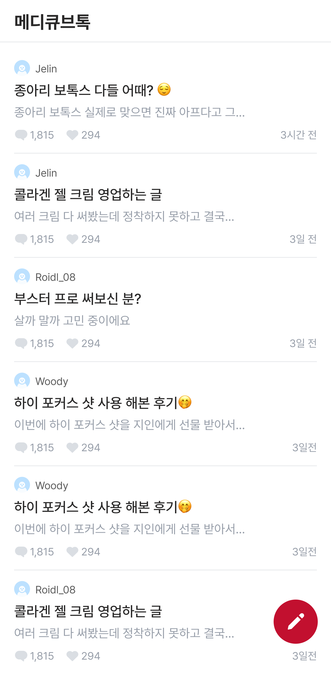
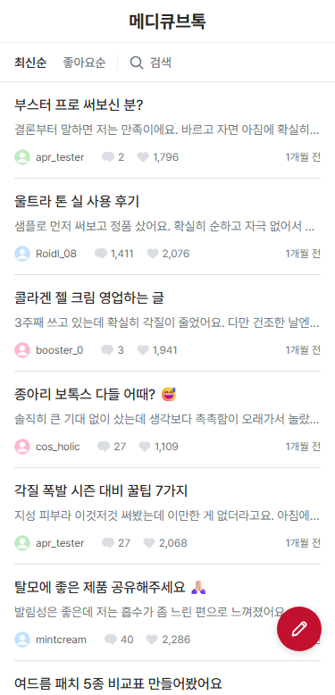
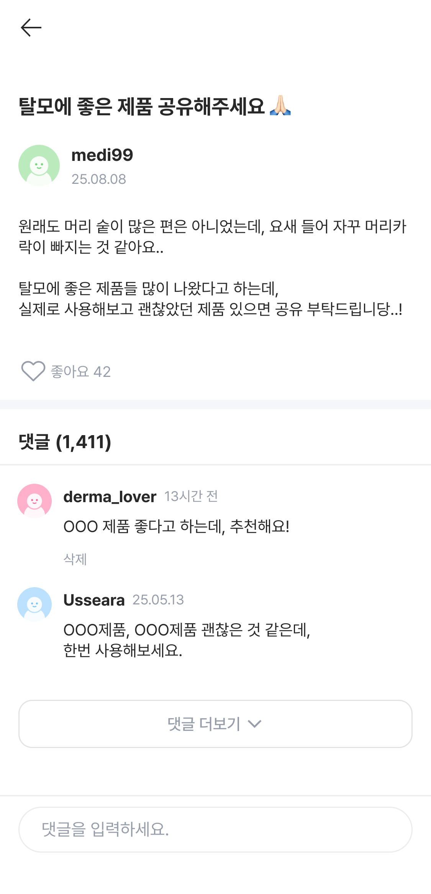
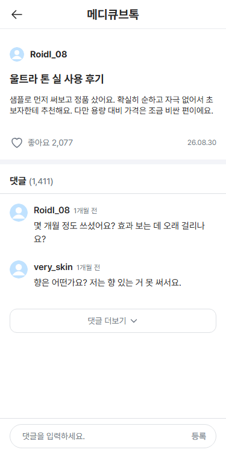
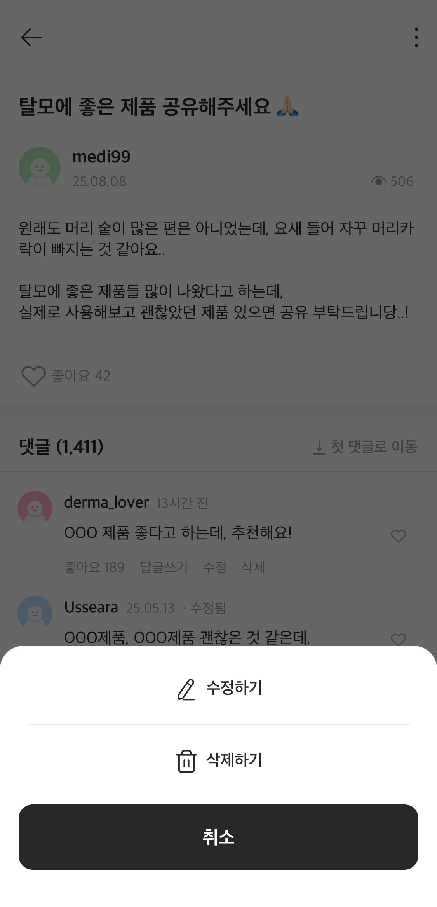
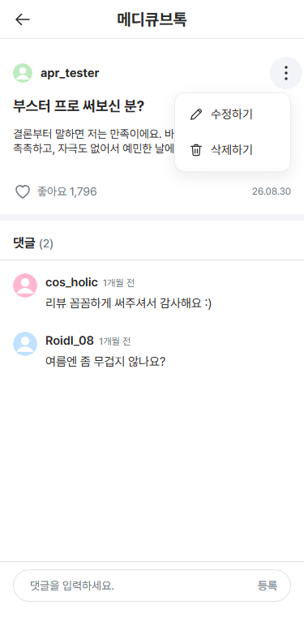

# 공식 Figma 최종 비교

## 범위

이 문서는 과제의 공식 디자인과 production 구현을 비교한 최종 V-081 기록입니다. V-081은 `main` `04dd668ae9d80d899edd8d363b42db5096bf4ac8`의 production 구현을 대상으로 수행했습니다.

공식 Figma가 정의한 요소를 375×778 Chromium 구현과 비교했고, 차이는 V-081 전에 이미 있던 product decision과 runtime 전용 동작을 기준으로 분류했습니다. 막아야 할 우발적 불일치는 발견되지 않았습니다.

*시점:* 이후 `main` `0baee43dc4b9733f67f39a43a741d35dd477eeb9`까지 `04dd668` 대비 git diff를 확인했습니다. 바뀐 것은 문서와 이 문서가 쓰는 runtime screenshot(`docs/assets/design-comparison/`)뿐이고, `frontend/`와 `design/`에는 변경이 없습니다. 따라서 V-081 결과는 그 시점의 production UI에도 그대로 적용됩니다.

## 비교 방법

- 공식 Figma: file `Ee1gp5NC6G1sQIvssuu4Sr`, Page 1 (`0:1`).
- V-081 중 공식 integration으로 file identity, Page 1 node tree, frame ID와 이름, mapping된 frame 12개가 모두 `375×778`인지를 다시 확인했습니다.
- 아래 visual baseline은 repository에 보존되어 있던 공식 Figma frame export입니다. V-081에서는 이 frame들의 현재 공식 file/node mapping을 다시 확인했을 뿐, 이 audit 중에 Figma에서 새로 export한 screenshot은 아닙니다.
- 현재 구현: production Compose build, Chromium CSS viewport `375×778`, DPR `1`, zoom `1`, 안정된 seed/requester context.
- 비교 기준은 frame metadata, rendered geometry, visual hierarchy, 그리고 V-081 전에 이미 있던 rationale입니다. pixel-difference threshold는 쓰지 않았습니다. browser font rasterization, renderer scaling, device scale 때문에 의미 없는 pixel 차이가 생길 수 있기 때문입니다.

## 분류 기준

- `DESIGN_DEFINED`: 공식 Figma frame이 명시적으로 보여 주는 presentation 또는 state.
- `PRODUCT_DECISION`: V-081 전에 이미 문서화된 의도적 구현 선택.
- `RUNTIME_ONLY`: static Figma frame이 정의하지 않는 동적 동작.
- `ACCIDENTAL_MISMATCH`: design-defined 영역에서 문서화된 근거 없이 생긴 차이.

`PRODUCT_DECISION`에 따른 차이는 `ACCIDENTAL_MISMATCH`가 아닙니다.

## 비교 범위 매트릭스

mapping된 공식 frame은 모두 `375×778`입니다. 목록 export 두 개는 4×(`1500×3112`), 나머지 열 개는 3×(`1125×2334`)로 보존되어 있습니다.

| Repository에 보존된 export | Figma node | 공식 state | 현재 구현 state | 결과 |
| --- | --- | --- | --- | --- |
| [`755-8831-post-list.png`](../design/design-export/755-8831-post-list.png) | `755:8831` | 게시글 목록 | `/`, latest 목록 | 비교함 |
| [`784-412-post-list-created-toast.png`](../design/design-export/784-412-post-list-created-toast.png) | `784:412` | 작성 후 목록, toast 표시 | 작성 성공 → `/` | 비교함 |
| [`755-10420-detail-own-unliked.png`](../design/design-export/755-10420-detail-own-unliked.png) | `755:10420` | 본인 글, 좋아요 안 함 | `/posts/1`, 좋아요 안 함 | 비교함 |
| [`755-10774-detail-own-liked.png`](../design/design-export/755-10774-detail-own-liked.png) | `755:10774` | 본인 글, 좋아요 함 | `/posts/1`, 좋아요 함 | 비교함 |
| [`830-139-detail-own-action-sheet.png`](../design/design-export/830-139-detail-own-action-sheet.png) | `830:139` | 본인 글 action bottom sheet | 본인 글 anchored popover | 비교함 |
| [`755-11707-post-delete-dialog.png`](../design/design-export/755-11707-post-delete-dialog.png) | `755:11707` | 게시글 삭제 확인 | 본인 글 삭제 dialog | 비교함 |
| [`755-12175-comment-delete-dialog.png`](../design/design-export/755-12175-comment-delete-dialog.png) | `755:12175` | 댓글 삭제 확인 | 본인 댓글 삭제 dialog | 비교함 |
| [`755-12645-detail-other-many-comments.png`](../design/design-export/755-12645-detail-other-many-comments.png) | `755:12645` | 다른 사용자 글, 댓글 여러 개 + 더보기 | `/posts/2`, 첫 댓글 2개 + 더보기 | 비교함 |
| [`755-13104-detail-other-one-comment.png`](../design/design-export/755-13104-detail-other-one-comment.png) | `755:13104` | 다른 사용자 글, 댓글 1개 | `/posts/24` | 비교함 |
| [`769-142-detail-other-no-comments.png`](../design/design-export/769-142-detail-other-no-comments.png) | `769:142` | 다른 사용자 글, 댓글 0개 | `/posts/10` | 비교함 |
| [`755-14007-create-empty.png`](../design/design-export/755-14007-create-empty.png) | `755:14007` | 빈 작성 form, action 비활성 | `/posts/new`, 빈 상태 | 비교함 |
| [`755-14046-create-valid.png`](../design/design-export/755-14046-create-valid.png) | `755:14046` | 입력된 작성 form, action 활성 | `/posts/new`, 유효한 입력 | 비교함 |
| 공유 작성 form geometry | — | 별도 수정 frame 없음 | `/posts/1/edit`, 값이 채워진 상태 | 따로 비교함 |

공식 Figma에는 수정 전용 frame이 없습니다. 수정 화면은 작성 form shell을 기준으로 geometry를 확인했고, 값이 채워진 `/posts/1/edit` 상태를 따로 비교했습니다.

## 대표 비교

공식 예시와 안정된 runtime seed는 text와 내용이 다릅니다. 비교 대상은 구조, state, presentation이며 글자 그대로의 내용 일치가 아닙니다.

### 1. 게시글 목록

<table>
  <tr>
    <th>공식 Figma</th>
    <th>현재 구현 — Chromium 375×778</th>
  </tr>
  <tr>
    <td></td>
    <td></td>
  </tr>
</table>

| 유지한 것 | 의도적 변경 | 이유 | 기존 rationale 출처 |
| --- | --- | --- | --- |
| 375px frame, Pretendard 기반 type/color, 구분선이 있는 compact 목록, 18px avatar, 오른쪽 정렬 시간, 오른쪽 아래 50px FAB | 44px latest/likes/search discovery toolbar | 별도 화면 없이 범위가 정해진 탐색 기능 추가 | [UI_SPEC §13](UI_SPEC.md), [ENGINEERING_NOTES §14](ENGINEERING_NOTES.md) |
| 각 row에 제목/preview/metadata가 계속 보임 | 제목 → preview → 작성자/반응/시간의 content-first 순서 | 제품 경험과 질문 내용을 우선 | [P8-C retouch 기록](../design/design-retouch/readme.md), [ENGINEERING_NOTES §14](ENGINEERING_NOTES.md) |
| Compact mobile rhythm | 공식 118px나 retouch 98px 대신 108px row | 375×778 검토에서 98px는 너무 빽빽했고, 108px는 가독성과 touch 간격을 지킴 | [UI_SPEC §12](UI_SPEC.md), [retouch 기록](../design/design-retouch/readme.md) |
| app identity와 목록 control은 위쪽에 유지 | 가운데 app title은 scroll되고 toolbar만 sticky | 48/44px 띠 두 개가 계속 화면을 차지하지 않게 함 | [UI_SPEC §12–13](UI_SPEC.md), [ENGINEERING_NOTES §14](ENGINEERING_NOTES.md) |

**분류:** `DESIGN_DEFINED` 요소를 유지하고, 문서화된 `PRODUCT_DECISION` 변경을 더함. **판정:** 우발적 불일치 없음.

### 2. 게시글 상세

<table>
  <tr>
    <th>공식 Figma</th>
    <th>현재 구현 — Chromium 375×778</th>
  </tr>
  <tr>
    <td></td>
    <td></td>
  </tr>
</table>

| 유지한 것 | 의도적 변경 | 이유 | 기존 rationale 출처 |
| --- | --- | --- | --- |
| 제목/본문/좋아요/댓글 hierarchy, 첫 댓글 2개, 더보기, 고정 composer, 주요 typography와 color 역할 | 제목 앞의 compact 24px byline, footer의 날짜, 본인/타인 글의 같은 geometry | 글 identity를 compact하게 두고 소유 상태에 따른 세로 이동을 없앰 | [UI_SPEC §12](UI_SPEC.md), [retouch 기록](../design/design-retouch/readme.md) |
| `댓글 (n)` heading과 49px box | label은 Bold 16/24, count는 Medium 14/20 | 댓글 위치를 바꾸지 않고 count를 보조 metadata로 다룸 | [UI_SPEC §12](UI_SPEC.md), [retouch 기록](../design/design-retouch/readme.md) |
| 고정 댓글 composer 영역과 placeholder | 입력란 안의 `등록` affordance | 과제가 요구하는 작성 action을 명시적으로 보여 줌 | [UI_SPEC P5B decisions](UI_SPEC.md) |

**분류:** `DESIGN_DEFINED` 구조에 문서화된 `PRODUCT_DECISION` 다듬기를 더함. **판정:** 우발적 불일치 없음.

### 3. 게시글 메뉴

<table>
  <tr>
    <th>공식 Figma</th>
    <th>현재 구현 — Chromium 375×778</th>
  </tr>
  <tr>
    <td></td>
    <td></td>
  </tr>
</table>

- **Figma:** 전체 화면 scrim, bottom sheet, `수정하기`, `삭제하기`, `취소`.
- **구현:** trigger 옆의 `144×98` popover(`PostActionMenu`), 44px command row 두 개, scrim 없음, 취소 row 없음.
- **유지한 안전장치:** 파괴적인 삭제는 여전히 scrim이 있는 modal 확인 dialog를 엽니다.
- **기존 rationale:** command가 두 개뿐이므로 trigger 옆에 두면 공간적·동작적 근접성이 좋아지고 불필요한 modal 무게가 사라집니다. [UI_SPEC §12](UI_SPEC.md), [ENGINEERING_NOTES §14](ENGINEERING_NOTES.md), [P8-C retouch 기록](../design/design-retouch/readme.md), V-081 이전 시점의 [V-081 P8-C 메모](VERIFICATION.md)를 참고하세요.

**분류:** `PRODUCT_DECISION`. **판정:** `INTENTIONAL_DEVIATION`.

## DESIGN_DEFINED 요약

| 요소/state | 공식 근거 | Runtime 근거 | 결과 |
| --- | --- | --- | --- |
| Frame | `375×778` frame 12개 | `375×778`, DPR 1, zoom 1 | 일치 |
| FAB | `(310,679)`의 `50×50` | `(310,679)`의 `50×50` | 일치 |
| 작성 toast | 대략 `(97.5,657)`의 `181×40` | 대략 `(97,658)`의 `181×40` | 일치 |
| 작성 action | `343×56`, 비활성/활성 state | `343×56`, radius 12, 두 state 모두 | 일치 |
| 좋아요 state | 좋아요 안 함과 `#FF8DA1` 좋아요 함 variant | 두 state 모두 render | 일치 |
| 댓글 범위 | 0개, 1개, 여러 개; 첫 댓글 2개 + 더보기 | 0개, 1개, 여러 개; 첫 댓글 2개 + 더보기 | 일치 |
| 삭제 dialog 핵심 | 327px 너비, radius 20, 56px action | 327px 너비, radius 20, 56px action | 일치; 높이/색 변경은 아래에 문서화 |
| 수정 geometry | 공유 작성 구조; 수정 전용 frame 없음 | 제목/본문이 채워진 공유 form | 공유 form 계약 안에서 일치 |

## 의도적 차이

아래 차이는 모두 V-081 전에 rationale이 있었고, 이 audit에서 새로 product 근거를 만들지 않았습니다.

| 의도적 차이 | 기존 rationale 출처 | 결과 |
| --- | --- | --- |
| Discovery toolbar | [UI_SPEC §13](UI_SPEC.md), [ENGINEERING_NOTES §14](ENGINEERING_NOTES.md) | `INTENTIONAL_DEVIATION` |
| Content-first 목록 hierarchy | [UI_SPEC §12](UI_SPEC.md), [retouch 기록](../design/design-retouch/readme.md), [ENGINEERING_NOTES §14](ENGINEERING_NOTES.md) | `INTENTIONAL_DEVIATION` |
| 108px row rhythm | [UI_SPEC §12](UI_SPEC.md), [retouch 기록](../design/design-retouch/readme.md) | `INTENTIONAL_DEVIATION` |
| 가운데 title / sticky toolbar 분리 | [UI_SPEC §12–13](UI_SPEC.md), [ENGINEERING_NOTES §14](ENGINEERING_NOTES.md) | `INTENTIONAL_DEVIATION` |
| Compact 상세 hierarchy | [UI_SPEC §12](UI_SPEC.md), [retouch 기록](../design/design-retouch/readme.md) | `INTENTIONAL_DEVIATION` |
| Bottom sheet → anchored popover | [UI_SPEC §12](UI_SPEC.md), [retouch 기록](../design/design-retouch/readme.md), [ENGINEERING_NOTES §14](ENGINEERING_NOTES.md) | `INTENTIONAL_DEVIATION` |
| 작성/수정 공통 form shell | [UI_SPEC §12와 P6 decisions](UI_SPEC.md) | `INTENTIONAL_DEVIATION` |
| Compact dialog / 빨간 파괴적 확인 | [retouch 기록](../design/design-retouch/readme.md), [UI_SPEC §12](UI_SPEC.md) | `INTENTIONAL_DEVIATION` |
| 읽기 쉬운 보조 text `#6E7785` | [UI_SPEC §6.3](UI_SPEC.md), [V-081 이전 상태 기록](VERIFICATION.md) | `INTENTIONAL_DEVIATION` |
| 댓글 count 강조 축소 | [UI_SPEC §12](UI_SPEC.md), [retouch 기록](../design/design-retouch/readme.md) | `INTENTIONAL_DEVIATION` |
| Composer 제출 affordance | [UI_SPEC P5B decisions](UI_SPEC.md) | `INTENTIONAL_DEVIATION` |

## Runtime 전용 상태

| State | Figma fidelity 범위 밖인 이유 |
| --- | --- |
| Loading, 요청 오류, retry | static frame에 없는 network/runtime 결과에 따라 달라짐 |
| Mutation pending/실패 | 요청 lifecycle에 따라 달라짐 |
| Infinite-scroll loading/오류 | 동적 pagination 동작 |
| Focus trap, Escape, keyboard loop | static presentation이 아닌 접근성 상호작용 |
| 취소, 요청 timing, cache 동작 | application architecture |
| Scroll 중 sticky 동작 | static frame 하나로는 확인할 수 없음 |

이 state들은 V-081에서 `OUTSIDE_FIGMA_FIDELITY`로 분류했습니다. 검증하지 않았다는 뜻이 아니라 Figma fidelity 비교 범위 밖이라는 뜻이며, 각각은 기존 runtime 근거로 따로 검증되어 있습니다.

## 우발적 불일치

`NONE`

## 결과

`V-081 PASS`

공식 mapping, export된 state 12개 전체, 공유 수정 form state, 대표 비교 3개가 `UI-004`에 충분한 근거가 됩니다.
